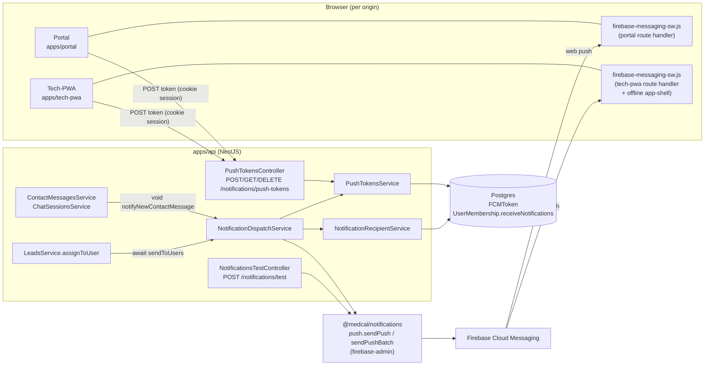
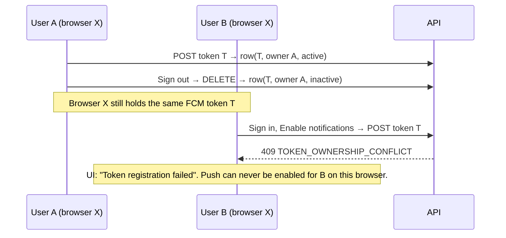

# Medcal FCM Push Notification — Implementation Audit Report

| | |
|---|---|
| **Date** | 2026-10-12 |
| **Type** | Audit of the *current* FCM implementation (read-only; no application code, schema, config or dependency was changed) |
| **Scope** | `apps/api`, `packages/notifications`, `packages/db` (FCM schema), `apps/portal`, `apps/tech-pwa`, deployment config (`docker-compose.prod.yml`, Dockerfiles, `.env*.example`), prior FCM docs |
| **Brief followed** | `docs/audits/Medcal FCM Integration - Comprehensive.md` (the audit brief; left untouched) |
| **Companion deliverable** | None. This report includes a prioritised remediation order (§12) but **not** a full implementation plan. |

> **Key to evidence labels.** **[V]** = verified from repository code/config (file:line given). **[T]** = verified by running the existing test suite. **[S]** = verified in the installed Firebase SDK source under `node_modules`. **[N]** = not verifiable from the repository (needs Firebase console, a browser or a device). **[R]** = recommendation / proposal, not an existing capability.

---

## 1. Executive summary

**FCM is already substantially implemented, not greenfield.** The pipeline *business event → recipient eligibility → active tokens → Firebase Admin → FCM → browser* exists end-to-end for the management portal, and the tech-pwa has the client half (token registration, service worker) but **no business event ever targets a technician**. [V]

The foundation is sound on the points that matter most for security: recipient identity is always server-derived, token ownership is enforced, Admin credentials are server-only, and the permission prompt is user-initiated. [V]

It is **not yet "proper"** for production use. The audit logged **17 findings (F-01…F-17): 5 high-severity, the rest medium or low**. The ones that most change the plan:

| # | Sev | Finding | One-line impact |
|---|---|---|---|
| F-01 | **High** | Account switching on one browser is broken | Second user gets `409 TOKEN_OWNERSHIP_CONFLICT`; push never enables for them |
| F-02 | **High** | Logout revocation is lost when the tab closes (sessionStorage) and the browser token is never deleted | Previous user's notifications keep arriving on a device someone else now uses |
| F-03 | **High** | Registering a token silently sets `receiveNotifications = true`, and dispatch ignores `FCMToken.app` | A technician enabling push in tech-pwa starts receiving **company-wide customer inquiry pushes**; it also overrides an admin's explicit opt-out |
| F-04 | **High** | `void this.notifyNewContactMessage(...)` can raise an unhandled rejection | A DB error inside dispatch can crash the API process on the public contact-form path |
| F-05 | **High** | Notification click does nothing, and foreground messages are silently dropped | Users can receive a push but cannot act on it; no in-app display when the app is open |

**Recommendation:** do not extend to tech-pwa business events yet. First fix F-01…F-05 in the portal path (small, mostly client-side and in `push-tokens`/dispatch, **no schema change needed**), then validate on real browsers, then proceed to tech-pwa. See §12.

**Test baseline:** the focused FCM-related Vitest run is **red (3 failed / 51 passed)** because of stale test mocks, not production defects (§10).

---

## 2. What was inspected and how

| Area | Inspected |
|---|---|
| Shared push library | `packages/notifications/src/push/{index,firebase-admin,contact-message}.ts`, `package.json` |
| API | `apps/api/src/modules/push-tokens/*` (controller, service, dispatch, recipient, test controller, module + tests), call sites in `contact-messages`, `chat`, `leads`, `users`; `common/guards/company-role.guard.ts`; `main.ts` |
| Auth / RBAC | `packages/auth/src/access-control.ts` (`notification:test`) |
| Schema | `packages/db/prisma/schema.prisma` (`FCMToken`, `PushApp`, `UserMembership.receiveNotifications`), migrations `20260813063336_init_better_auth_fcmtoken`, `20260822180000_add_user_membership_receive_notifications` |
| Portal | `src/lib/fcm/*`, `src/app/firebase-messaging-sw.js/route.ts`, `src/proxy.ts`, `components/sign-out-button.tsx`, `components/management/header-controls.tsx` |
| Tech-pwa | `src/lib/fcm/*`, `src/app/firebase-messaging-sw.js/route.ts`, `components/layout/{sw-register,account-menu}.tsx`, `components/sign-out-button.tsx`, `public/manifest.webmanifest`, `public/` assets |
| Deployment | `docker-compose.prod.yml`, `apps/{portal,tech-pwa}/Dockerfile`, `.env.example`, `.env.production.example` (**variable names only; no values read or reproduced**), `packages/config/src/index.ts` |
| SDK behaviour | `@firebase/messaging@0.13.2` service-worker source in `node_modules/.pnpm` (click and foreground handling) |
| Prior docs | `docs/cursor/plan/FCM/*` (roadmap and phase reports) |
| Tests | Focused Vitest run (§10) |

**Not inspected / cannot be verified from the repo [N]:** the Firebase console (project, VAPID key validity, whether the web app config matches), production `.env.production` values, real delivery on any browser/device, `apps/web-api` spam/CAPTCHA controls on the public contact form, `apps/customer-portal` (compose file states it has no FCM), and the technician-domain docs under `docs/claude/plans/technician-app/` beyond keyword hits.

---

## 3. Verified current architecture

### 3.1 Component map



### 3.2 Facts about the stack [V]

| Topic | Finding | Evidence |
|---|---|---|
| Backend | NestJS; `CompanyRoleGuard` resolves `companyId` **only** from the caller's own `UserMembership` for the deployment's `COMPANY_ID` env (single-company deployment); requires ACTIVE user | `apps/api/src/common/guards/company-role.guard.ts:34-67` |
| Frontends | Both are Next.js App Router apps; both use `apiFetch` from `@medcal/shared` with cookie sessions | `apps/*/src/lib/fcm/register.ts:25` |
| Firebase Web SDK | `firebase@^12.18.0` (installed 12.18.0) in both apps | `apps/portal/package.json:32`, `apps/tech-pwa/package.json:17` |
| Firebase Admin | `firebase-admin@^14.3.0` (installed 14.3.0), isolated in `packages/notifications` | `packages/notifications/package.json:14` |
| Admin credential | `FIREBASE_SERVICE_ACCOUNT_JSON` env var, lazy init, server-only; optional in env schema | `firebase-admin.ts:22-44`, `packages/config/src/index.ts:55-58` |
| Public Firebase config | `NEXT_PUBLIC_FIREBASE_*` + `NEXT_PUBLIC_FIREBASE_VAPID_KEY` as Docker **build args** for portal and tech-pwa (same Firebase project/app) | `docker-compose.prod.yml:140-149, 175-185` |
| Service worker | **Dynamic route handler** at `/firebase-messaging-sw.js`, `Cache-Control: no-store`, `Service-Worker-Allowed: /`; Firebase compat scripts pulled by `importScripts` from `gstatic.com` pinned at `12.18.0` | `apps/*/src/app/firebase-messaging-sw.js/route.ts` |
| Portal SW | Background handler only | portal `route.ts:25-45` |
| Tech-pwa SW | Background handler **plus** an offline app-shell (`install`/`activate`/`fetch`, cache `tech-pwa-shell-v1`, navigation-only fallback to `/offline.html`). One SW is shared for FCM and offline because only one is allowed per scope | tech-pwa `route.ts:42-66`, `sw-register.tsx:5-21` |
| Portal SW registration | **On demand**, only when obtaining a token | portal `messaging.ts:62-76, 188` |
| Tech-pwa SW registration | **Always on** at app start (`<SwRegister/>`), independent of push opt-in | `sw-register.tsx:12-21` |
| Portal routing | `proxy.ts` matcher excludes `/firebase-messaging-sw.js` from host-group rewrite, with a test | `apps/portal/src/proxy.ts:34-39`, `proxy.test.ts:18` |
| Background jobs | **None** for notifications. The only timer in the API is the RolePermission cache refresh | `apps/api/src/main.ts:34` |
| Rate limiting | **None.** No throttler/rate-limit code anywhere in `apps/api/src` | grep result |
| Other FCM-adjacent mechanisms | Realtime sync via `publishContactMessageCreated` (socket) is separate and not part of FCM | `contact-message-events.ts:29` |

### 3.3 Data model [V]

```text
FCMToken  (schema.prisma:793-808)
  id, companyId, userId, token @unique, deviceType, app: PushApp,
  isActive default true, lastUsedAt?, createdAt, updatedAt
  @@index([companyId, userId])
  FK companyId, userId  → ON DELETE CASCADE

enum PushApp { WEB, PORTAL, TECH_PWA }            (schema.prisma:57-61)
UserMembership.receiveNotifications Boolean default false   (schema.prisma:680)
```

`token` is **globally unique**, so one browser token can belong to exactly one row/user at a time. This is the root of F-01.

### 3.4 API surface [V]

| Route | Guard / permission | Behaviour |
|---|---|---|
| `POST /notifications/push-tokens` | `CompanyRoleGuard` (session + ACTIVE + membership), no extra permission (own-resource) | zod `{token, deviceType≤100, app ∈ WEB/PORTAL/TECH_PWA}`; `userId`/`companyId` from session; create or reactivate; **sets `receiveNotifications=true`** |
| `GET /notifications/push-tokens` | same | Lists caller's active tokens (returns raw token strings) |
| `DELETE /notifications/push-tokens/:tokenId` | same | Soft-deactivates; foreign/unknown id → 404 |
| `POST /notifications/test` | `@RequirePermission("notification","test")` — SUPERADMIN-only by default (no RolePermission rows seeded) | Sends arbitrary title/body to an arbitrary token |
| `PATCH /users/:id/memberships/notification-settings` | `membership:manage` | Admin toggles `receiveNotifications` |

### 3.5 Business events currently wired [V]

| Event | Trigger | Recipients | Delivery |
|---|---|---|---|
| `CONTACT_MESSAGE_NEW` | After `ContactMessagesService.create` (only when `tx === prisma`) and after `ChatSessionsService.createSession` commit | **All** ACTIVE company members with `receiveNotifications=true` | `void` fire-and-forget (`contact-messages.service.ts:198-201`, `chat-sessions.service.ts:98-101`) |
| `LEAD_ASSIGNED` | `LeadsService.assignToUser` after the update | The assignee (if eligible) | `await` inline, no try/catch (`leads.service.ts:207-220`) |

**No technician-facing event exists.** `WorkOrdersService.assign` (`work-orders.service.ts:490-541`) does not call the dispatch service.

---

## 4. Verified strengths (keep these)

1. **Server-derived identity.** `userId`/`companyId` never come from the client; the zod schema has no such fields (`push-tokens.controller.ts:33-39`). [V]
2. **Ownership enforcement.** Foreign token registration → 409; foreign token revocation → 404 (no existence leak) (`push-tokens.service.ts:71-79, 134-152`). [V]
3. **Admin SDK isolation.** Credentials are read only in `packages/notifications`, never in a `NEXT_PUBLIC_*` variable; compose file comment explicitly forbids passing them as build args. [V]
4. **Eligibility ≠ RBAC.** Recipient filter requires membership + `receiveNotifications` + `User.status = ACTIVE` (`notification-recipient.service.ts:19-36`). [V]
5. **Invalid-token cleanup** exists for the two main FCM error codes and is covered by a test. [V]
6. **Log hygiene.** Tokens are redacted in logs; initialisation errors log only the message (`index.ts:98-106`, `firebase-admin.ts:41`). [V]
7. **Permission UX.** The browser prompt is requested only from an explicit click ("Enable notifications"); `unsupported`, `unconfigured`, `denied`, `enabling`, `error` states are all handled (`use-push-notifications.ts`). [V]
8. **SW delivery headers** are correct for a service worker (`no-store`, `Service-Worker-Allowed`) and the portal proxy test guards the route. [V]
9. **Test endpoint is locked down** by a dedicated permission that no role has by default. [V]

---

## 5. Findings

Severity: **High** = incorrect behaviour or privacy/availability risk in the current feature; **Medium** = reliability/observability/UX gap that will bite at scale or on tech-pwa; **Low** = hygiene.

### F-01 — Account switching on one browser fails permanently (High) [V]

**Evidence.** `registerToken` does a global lookup by `token` and throws `ConflictException` if the row belongs to another user, *regardless of `isActive`* (`push-tokens.service.ts:67-79`). Sign-out only calls the backend `DELETE` (soft-deactivate) and clears sessionStorage (`register.ts:83-89`); **`deleteToken()` is never called** — a grep for `deleteToken`/`unsubscribe` across both apps returns nothing. The browser therefore keeps the same FCM token across users.



**Impact.** Shared workstations and shared technician phones/tablets (plausible for tech-pwa) cannot be used by a second person. The design comment "Cross-user token reassignment is prohibited" turned a deliberate security invariant into a functional dead end.

**Decision needed (this touches a deliberate invariant — do not change silently):** either (a) client calls `deleteToken(messaging)` on sign-out so the next user mints a fresh token (no server change, preferred), and/or (b) server permits takeover when the existing row is `isActive=false`, or when the authenticated caller presents the token (possession of an FCM token proves control of that browser profile).

### F-02 — Logout revocation is unreliable; previous user keeps receiving pushes (High) [V]

**Evidence.** The token row id used for revocation is stored in **`sessionStorage`** (`messaging.ts:10-12, 243-259`), which is per-tab and discarded when the tab/browser closes. Revocation exists only in `SignOutButton` (`sign-out-button.tsx:13-17`). Session expiry, a cleared cookie, or sign-out after a browser restart skips it. The row stays `isActive=true` for user A while the browser may now be used by someone else.

**Impact.** Notifications for user A (customer names, message previews, lead names) continue to display on a device A is no longer signed in on. `NotificationRecipientService` only checks that A is ACTIVE; it does not know A has no session.

**Related:** F-09 (sign-out can fail), F-12 (no stale-token pruning).

### F-03 — Implicit opt-in and no app-based targeting (High) [V]

**Evidence.**

- `ensureMembershipReceivesNotifications` runs `updateMany({ data: { receiveNotifications: true } })` on **every** registration, create or refresh (`push-tokens.service.ts:39-47, 94, 116`). It is unconditional.
- `getActiveTokensForUserIds` filters by company, user and `isActive` only — **not by `app`** (`push-tokens.service.ts:179-192`). `sendToCompanyRecipients` therefore sends `CONTACT_MESSAGE_NEW` to *every* active token of every eligible user, including `TECH_PWA` tokens.
- Revoking a token or signing out never resets `receiveNotifications`.

**Impact.**
1. A technician who taps "Aktifkan notifikasi" in tech-pwa becomes a recipient of customer inquiry pushes (sender name + message preview) that are irrelevant to them and not intended for technicians.
2. An admin who set `receiveNotifications=false` (`PATCH /users/:id/memberships/notification-settings`, `membership:manage`) is silently overridden the next time that user clicks Enable.
3. The "eligibility is a business setting, not a permission" design in the schema comment (`schema.prisma:678-680`) is undermined because the user can self-grant it.

**Needs a product decision:** is `receiveNotifications` meant to be admin-controlled, self-service, or per-notification-type? The existing docs defer "Notification Types + Recipient Assignment" to roadmap Phase 4–5 (§9), but the implementation already shipped a coarse version of it.

### F-04 — Unhandled-rejection path on fire-and-forget dispatch (High) [V, not reproduced]

**Evidence.** `void this.notifyNewContactMessage(...)` (`contact-messages.service.ts:199`, `chat-sessions.service.ts:99`). `sendPush`/`sendPushBatch` swallow Firebase errors, but everything around them does not: `prisma.contactMessage.findFirst` (`:215`), `resolveEligibleUserIds`, `getActiveTokensForUserIds`, and `deactivateByToken` in a loop (`notification-dispatch.service.ts:51-63, 117`) have no try/catch. `main.ts` registers no `unhandledRejection` handler. Package engines require Node ≥ 20 (`package.json:22`), where an unhandled rejection terminates the process by default.

**Impact.** A transient DB error during notification on the **public** contact-form path can take down the API process *after* the message was already stored.

### F-05 — Click does nothing; foreground pushes are dropped (High for "proper" delivery) [V][S]

**Click.** The message sets no `webpush.fcmOptions.link` and the SW defines no `notificationclick` handler (`buildFcmMessage`, `index.ts:53-76`; SW routes). In the SDK, a click on a notification with no link "will focus the Chrome's current tab" and returns (`@firebase/messaging index.sw.esm.js:1442-1446`) [S]. The data payload carries `contactMessageId`/`leadId` but nothing uses it, so the user cannot be taken to the message or lead.

**Foreground.** When any window client is visible, the SDK forwards the payload to the page and **does not** show an OS notification (`index.sw.esm.js:1409-1411`) [S]. Neither app calls `onMessage` (grep: no match in portal/tech-pwa). Result: if the portal tab is open and focused, the push is silently discarded. For contact messages the existing socket/realtime control partly compensates; for `LEAD_ASSIGNED` nothing does.

**Also:** the `if (payload.notification?.title) return` branch in both SWs makes the data-only fallback dead code, since the backend always sends a `notification` block.

### F-06 — Token sync only runs when the account dropdown is open (Medium) [V]

`usePushNotifications` is called inside `PushNotificationsMenuItem` / `PushStatusItem`, which are rendered only inside the open dropdown (`header-controls.tsx:198, 215`; `account-menu.tsx:20, ~96-106`). Consequences:

- A returning user with permission already granted does **not** get token re-sync/rotation handling until they happen to open the menu.
- First-time users see no prompt or hint unless they open the menu (discoverability).
- Each menu open re-runs `getToken` (hydrate effect).

### F-07 — Registration race and missing input bounds (Medium) [V]

`registerToken` is `findUnique` → `create` with no upsert and no P2002 handling (`push-tokens.service.ts:67-114`). Two tabs (empty sessionStorage each) or a React Strict-Mode double effect can issue concurrent POSTs for the same new token; the loser gets an unhandled unique-violation → 500. `token` has no `max()` in the zod schema (`push-tokens.controller.ts:34`); a very long string would hit Postgres btree key limits on the `@unique` index and also 500.

### F-08 — No delivery tracking, retry, or observability (Medium) [V]

- Dispatch results (`tokens/sent/failed/deactivated`) are returned and then **discarded** by both callers; failures surface only as `console.error` in the shared package.
- Non-token errors (`UNAVAILABLE`, `INTERNAL`, quota) are not retried.
- `sendEach` is called with *all* tokens in one request (`notification-dispatch.service.ts:102`); the Admin SDK limits a batch to 500 messages, so fan-out above that fails as a whole (error caught, all marked failed) [S-knowledge, not re-verified in SDK source here].
- Invalid-token detection checks only `invalid-registration-token` and `registration-token-not-registered` (`index.ts:93-96`). A malformed token may surface as `messaging/invalid-argument` instead; this needs a controlled test with a deliberately malformed token before relying on cleanup. [N]
- Fire-and-forget after commit means an event is lost if the process dies between commit and dispatch. At the current scale (single company, small opted-in staff) this is an acceptable trade-off **provided** F-04 is fixed and failures are logged; an outbox is *not* justified yet (§11).

### F-09 — Sign-out can fail when the revoke call fails, especially offline (Medium) [V]

`revokePushTokenWithBackend` uses a raw `fetch` with no try/catch (`register.ts:35-44`). A network failure rejects, the `onClick` handler throws at `await revokeRegisteredPushToken()`, and `signOut()` is never reached (`sign-out-button.tsx:13-17`). For tech-pwa — an app with an offline shell whose users work in the field — this means **sign-out can be blocked by being offline**. It also bypasses `apiFetch` conventions (`NEXT_PUBLIC_API_URL` is concatenated manually).

### F-10 — Notification content and privacy (Medium) [V + decision]

`formatContactMessagePush` puts the **customer's name** in the title and a **120-char message preview** in the body; `data` additionally carries `sender`, `company`, `topic`, `leadId`, `contactMessageId`, `companyId` (`contact-message.ts:30-51`). `LEAD_ASSIGNED` puts the lead's name in the body (`leads.service.ts:212-213`). This content is shown on lock screens and transits Google's FCM infrastructure. The shared module's own doc comment says "sensitive data should be fetched from API after click" (`index.ts:20-21`) — current behaviour does not follow it. Combined with F-02/F-03 the exposure surface is wider than intended.

**Open question for the product owner:** is showing customer name/preview on device acceptable for staff devices, and is it acceptable for technicians' personal phones? (F-03 currently routes it there.)

### F-11 — No TTL, collapse key, or urgency (Low–Medium) [V]

Messages are sent with FCM defaults (≈ 4-week TTL). A device that is offline for days will receive a stack of stale "new message" pushes later. There is no `webpush.headers.TTL`/`Topic` (collapse) setting, and a burst of contact-form submissions produces one push per submission per token with no coalescing. There is also no rate limiting anywhere in the API (§3.2); spam protection for the public form lives upstream in `apps/web-api`, which was **not** audited here. [N]

### F-12 — No stale-token lifecycle (Medium) [V]

`lastUsedAt` is only written on registration (`push-tokens.service.ts:85, 111`), never on successful delivery. Nothing prunes `isActive=false` or long-unused rows, and there is no scheduler to do so. FCM expects apps to remove tokens that have been inactive for a long period. Also, `isActive=false` rows keep owning the unique `token` value (the cause of F-01).

### F-13 — Service-worker robustness (Low–Medium) [V]

1. **CDN coupling.** Both SWs `importScripts` Firebase from `gstatic.com`; the version is a hard-coded constant (`12.18.0`) that must be kept in sync with the npm dependency (`^12.18.0`). In tech-pwa, a failed `importScripts` at install/update time prevents the SW — and therefore the **offline app shell** — from installing. Pushes and offline fallback share one failure domain.
2. **Install atomicity.** `cache.addAll(["/offline.html","/icons/icon-192.png","/short-logo.png"])` rejects the whole install if any asset 404s. All three exist today (`apps/tech-pwa/public/`). Any future rename silently disables the SW.
3. **Inaccurate comments.** Both route handlers say values are "injected at runtime", but `docker-compose.prod.yml:172-176` and the tech-pwa Dockerfile document that `NEXT_PUBLIC_*` are inlined at build time. Rotating Firebase web config requires a rebuild.
4. **`getRegistration(SW_PATH)`** in tech-pwa (`messaging.ts:72`) passes a script path where the API expects a client URL; it only works because the SW scope is `/`. The `?? navigator.serviceWorker.ready` fallback is returned un-awaited inside the `try`, so its rejection isn't caught.

### F-14 — Duplication and leftovers (Low) [V]

`messaging.ts`, `register.ts`, `permission.ts`, `flow.ts` and `use-push-notifications.ts` are near-verbatim copies in portal and tech-pwa (differences: `app` value, SW registration strategy, sessionStorage key prefix, portal's activation-wait helper). Only the portal has unit tests for the pure flow logic (`apps/portal/src/lib/fcm/flow.test.ts`). A debug `console.log("[fcm] pre-getToken", …)` remains in `apps/portal/src/lib/fcm/messaging.ts:198`.

### F-15 — Red test baseline (Low, but blocks "all green" gating) [T]

See §10. 3 of 54 focused tests fail; all in test code (stale mock; leaked mock call history).

### F-16 — Documentation drift (Low) [V]

`docs/cursor/plan/FCM/FCM_Implementation_Roadmap.md` lists Phase 3 (backend sending) as "NEXT" and Phases 4–10 as TODO, but the code already implements backend sending, eligibility (`receiveNotifications`), and two business events. The roadmap is no longer a reliable description of the system; this report supersedes it for current-state purposes.

### F-17 — Minor API/model observations (Low) [V]

- `PushApp.WEB` is accepted by the API but no client sends it.
- `app` is client-supplied and trusted for storage; harmless today because dispatch ignores it, but it becomes security-relevant the moment F-03 is fixed by filtering on `app` (the server should then derive or validate it, e.g. against request origin).
- `GET /notifications/push-tokens` returns raw token strings to the client (own tokens only).
- `LeadsService.assignToUser` has no actor parameter, so self-assignment notifies the actor.
- `LeadsService.assignToUser` awaits dispatch with no try/catch (`:207-220`): a dispatch exception returns 500 *after* the assignment was committed, inviting a client retry. (Same root cause as F-04, different symptom.)

---

## 6. Browser / platform behaviour (what the code covers)

| Concern | Status |
|---|---|
| HTTPS / secure context | Deployment is behind HTTPS per compose/infra docs; SW requires it. Not testable here. [N] |
| Permission requested on load? | No — only on click. ✔ [V] |
| Denied / unsupported / unconfigured | Handled with distinct statuses and messages. ✔ [V] |
| Permission revoked after enabling | `hydrate` re-reads `Notification.permission` on mount → shows `denied`. Server row stays active until FCM reports it invalid (F-12). [V] |
| Token rotation / refresh | Relies on Firebase SDK + re-sync on next dropdown open (F-06). No `onTokenRefresh`-style handling in v12 beyond `getToken` re-call. [V] |
| Multi-tab | No cross-tab coordination; concurrent POST race (F-07). [V] |
| Multiple devices / browsers per user | Supported: each browser has its own token row; dispatch fans out to all active tokens. ✔ [V] |
| iOS / Safari | Web push on iOS generally requires the PWA to be installed to the home screen; `isSupported()` gates the UI. tech-pwa has a standalone manifest. Behaviour on real devices was **not** verified. [N] |
| Service-worker update | Script served `no-store`, so updates are picked up; tech-pwa uses `skipWaiting` + `clients.claim`. [V] |
| Offline | tech-pwa offline fallback is navigation-only; no data/JS caching (documented intent in the SW). Push delivery while offline is handled by FCM queueing (TTL, F-11). [V] |

---

## 7. Security and privacy assessment

| Area | Assessment |
|---|---|
| Secret exposure | **Pass.** Admin JSON server-only; web config/VAPID are public by design; compose comments forbid leaking Admin creds; SW contains only public config. |
| AuthN/Z on token endpoints | **Pass** (session + ACTIVE + membership; own-resource semantics; 404 on foreign revoke). |
| Targeting integrity | **Partial.** Recipient lists are server-derived, but eligibility is self-grantable (F-03) and cannot be tied to the current session (F-02). |
| Test relay endpoint | **Pass with note.** SUPERADMIN-only; accepts any token and arbitrary text. Acceptable as an admin diagnostic; it is not a general relay. |
| PII in payloads | **Needs decision** (F-10). |
| Abuse controls | **Gap.** No rate limiting on any API route; no dedupe/collapse (F-11). |
| Token lifecycle | **Gap** (F-01, F-02, F-12). |
| Logging | **Pass** (redaction) but **insufficient** for troubleshooting (F-08). |

No new RBAC role or permission appears necessary. The only permission involved is the existing `membership:manage` (opt-in toggle) and `notification:test`.

---

## 8. Event inventory and tech-pwa readiness

### 8.1 Existing events

See §3.5. Both are triggered from authoritative server code, but neither is transactional with dispatch (post-commit, best-effort).

### 8.2 Candidate events for tech-pwa (grounded, **unconfirmed** — product decision required)

| Candidate | Grounding in code | Recipient resolution | Notes |
|---|---|---|---|
| Work order assigned to technician | `WorkOrdersService.assign` creates `WorkOrderAssignment` rows inside `$transaction` and sets status `ASSIGNED` (`work-orders.service.ts:490-541`) | `technicianUserId` on each assignment — already server-derived and validated ACTIVE + company member | Natural first technician event. Dispatch would go **after** the transaction commits. Deep link must authorize against the assignment when opened. |

Other technician lifecycle events (e.g. review/rework outcomes) are mentioned in `docs/claude/plans/technician-app/ui-tasks/`, but they were not analysed as triggers here, and none should be treated as a confirmed requirement. **Open question:** which technician events are wanted in the first release?

### 8.3 What tech-pwa lacks before any event can ship

1. App-scoped targeting so technician events go only to `TECH_PWA` tokens and sales events only to `PORTAL`/`WEB` tokens (F-03).
2. A click destination route and its authorization check (F-05).
3. Reliable logout/shared-device handling (F-01, F-02, F-09) — materially more important for field devices.
4. A decision on payload privacy for personal phones (F-10).

---

## 9. Alignment with project rules and prior phases

- `.claude/rules/architecture.md` Phase 4 invariants (measurement model etc.) are **not touched** by anything in this audit; FCM is orthogonal.
- Recommendations below deliberately avoid: new tables, a queue, Redis, an outbox, a state-management library, or an inbox/notification-center. These were not justified by verified failure modes.
- The one place a **schema change could** be argued is F-03 (per-notification-type opt-in) — this is *not* recommended yet; a filter on the existing `FCMToken.app` column plus fixing the implicit opt-in covers the verified problems.
- This is an explicitly requested audit, so it does not conflict with the "no audit loop" rule.

---

## 10. Test evidence

**Command (run once, output saved unfiltered):**

```text
pnpm --filter @medcal/api exec vitest run \
  src/modules/push-tokens \
  src/modules/contact-messages/contact-messages.push.test.ts \
  src/modules/leads/leads.service.test.ts
```

| Metric | Result |
|---|---|
| Vitest test files | **4 passed / 2 failed** (6 total) |
| Vitest tests | **51 passed / 3 failed / 0 skipped** (54 total) |
| Full API suite | **Not run** (not required for an audit; no code was changed) |
| Typecheck / build | **Not run** |
| Portal / tech-pwa tests | **Not run** (portal has `flow.test.ts`, `proxy.test.ts`; tech-pwa has none for FCM) |

**Failures (all test-side):**

| Test | Cause |
|---|---|
| `notification-dispatch.service.test.ts` › *E — sends to all active tokens … (multi-device)* | Test mocks `@medcal/notifications` with only `push.sendPushBatch`; production now calls `push.resolvePushIconUrl()` (`notification-dispatch.service.ts:94`) → `TypeError: push.resolvePushIconUrl is not a function` |
| `notification-dispatch.service.test.ts` › *deactivates invalid tokens after batch send failures* | Same stale mock |
| `contact-messages.push.test.ts` › *no-ops when dispatch service is not injected* | `prisma.contactMessage.findFirst` is a module-level `vi.fn()` shared with the previous test and never cleared, so the "not called" assertion sees the previous test's call. The production code path (`if (!this.notificationDispatch) return`) is correct |

I did not modify any test. Fixing them is a prerequisite for using the suite as a regression gate.

**Side effect to disclose.** The API Vitest `globalSetup` truncates and reseeds the dedicated test database addressed by `TEST_DATABASE_URL` (`pkmdb_test`, distinct from the dev `pkmdb`), before and after the run. No non-test database was addressed.

**Coverage that exists:** token service (ownership, reactivation, revoke), recipient eligibility, dispatch zero-paths, test controller, contact-message formatting, icon URL resolution, portal flow logic, portal proxy matcher.
**Coverage that is missing:** account switching (F-01), logout with lost sessionStorage (F-02), implicit opt-in/app filter (F-03), dispatch exceptions (F-04), concurrent registration (F-07), >500 tokens, any browser/SW behaviour, tech-pwa client logic.

---

## 11. Design decisions (with alternatives)

| Decision | Recommendation | Rationale | Alternatives considered |
|---|---|---|---|
| Sync vs queue | Keep **in-process dispatch**; wrap in try/catch, log result, handle rejection | Single-company deployment, tiny recipient set, no job runner exists; failures are explained by F-04/F-08, not by lack of a queue | BullMQ/Redis (new infra, unjustified); outbox table (only warranted if lost-on-crash events become a stated requirement) |
| Provider abstraction | Keep `packages/notifications` as is | Already isolates Admin SDK and is domain-neutral | Further abstraction — speculative |
| Token model | Keep single `FCMToken` table, add behaviour not columns | Verified problems are behavioural | Per-app tables or subscription contexts — unnecessary; `app` column already exists |
| Shared-device handling | Prefer client-side `deleteToken()` on sign-out + best-effort revoke that never blocks sign-out | Fixes F-01/F-02/F-09 without relaxing a server security invariant | Server takeover of inactive rows (simpler for users, weaker invariant) — decision for owner |
| Opt-in model | Make registration **not** mutate `receiveNotifications`; admin toggle stays the source of truth | Restores the schema's stated intent | Self-service opt-in (then drop admin toggle semantics) — product call |
| Targeting | Filter tokens by `app` per event class | Uses existing column | Per-user "notification type" preferences — roadmap Phase 4–5, defer |
| Click routing | Add `webpush.fcmOptions.link` (same-origin path) and a minimal `notificationclick` fallback; destination page re-authorizes | SDK already supports link-based open/focus | Custom SW routing — only if links prove insufficient |
| Foreground | Add a single `onMessage` listener (one per app root, unsubscribed on unmount) feeding the existing UI toast/realtime channels | Avoids silent drop | Full in-app inbox — explicitly out of scope |

---

## 12. Recommended remediation order

*(Prioritised order only; each step is small and independently shippable. Awaiting approval before any implementation.)*

**Stage 0 — Correctness and safety (portal path, before any new events)**
1. F-04/F-17: wrap dispatch (`notifyNewContactMessage`, `LeadsService.assignToUser`) in try/catch + logged result; never let notification failure fail or crash the business action.
2. F-01/F-02/F-09: on sign-out, best-effort revoke (swallow errors, never block `signOut()`), call `deleteToken()`, and stop depending on sessionStorage for the revoke id (e.g. revoke by token string for the current user).
3. F-03: stop auto-setting `receiveNotifications` on registration; filter dispatch tokens by `app`. *(Decision: who controls opt-in?)*
4. F-07: make registration idempotent (upsert / handle unique-violation); add `max()` on token length.
5. F-15: repair the three failing tests; add tests for items 1–4.

**Stage 1 — Make a delivered notification useful**
6. F-05: add `fcmOptions.link` + `onMessage`; define destination pages and their authorization.
7. F-06: mount the sync hook at app level (not inside the dropdown), keep the explicit "Enable" click for the permission prompt.
8. F-11: set `webpush.headers.TTL`, and a collapse `Topic` where appropriate.
9. F-10: decide payload content (generic title vs name/preview).

**Stage 2 — Validate on real browsers/devices** *(gate before tech-pwa)*: Chrome/Edge desktop, Android Chrome, iOS installed PWA; test matrix in §13.

**Stage 3 — Tech-pwa**: confirm event list (§8.2), add `WorkOrdersService.assign` dispatch after commit, app-scoped targeting, shared-device handling verification, consolidate duplicated client code only if it blocks the above (F-14).

**Stage 4 — Hardening (only if needed)**: delivery-attempt logging, stale-token pruning (F-12), chunking above 500 tokens (F-08). Reconsider an outbox only if lost-on-crash events become a requirement.

---

## 13. Suggested acceptance/test matrix

| Area | Automated (Vitest, no Firebase needed) | Needs Firebase credentials / HTTPS / real browser |
|---|---|---|
| Token registration | new, repeat, reactivate, foreign-owner, concurrent, over-long token | Real token from `getToken` |
| Revocation | by owner, by non-owner (404), sign-out with network failure | `deleteToken()` really invalidates push |
| Account switching | user A → sign-out → user B same token (server rule after decision) | Two accounts on one real browser profile |
| Eligibility | opt-out respected; registration doesn't flip flag; `app` filter | — |
| Dispatch | exception in each stage doesn't propagate; >500 tokens chunks; invalid tokens deactivated incl. `invalid-argument` | Malformed-token and unregistered-token behaviour against real FCM |
| Payload | no PII beyond agreed content; link is same-origin path | Lock-screen rendering |
| Click / foreground | pure link-building tests | Click opens/focuses correct page; foreground toast; background OS notification |
| PWA regression (tech-pwa) | SW source contains expected handlers | Offline fallback still works after SW update; install with CDN blocked |
| Permission states | `flow.ts` tests (add to tech-pwa) | Granted, denied, revoked after enabling, unsupported browser |

Each stage should be accepted only when its automated column passes in the **full** relevant Vitest suite and the manual column is signed off on the listed browsers.

---

## 14. Open questions / prerequisites

1. **Opt-in ownership:** admin-controlled, self-service, or per-type? (F-03)
2. **Shared-device rule:** is client `deleteToken()` sufficient, or should the server allow takeover of inactive rows? (F-01)
3. **Payload privacy:** is customer name/preview acceptable on lock screens and on technicians' phones? (F-10)
4. **Tech-pwa event list** for the first release. (§8.2)
5. **Firebase console state** [N]: confirm the project, that the VAPID key matches `NEXT_PUBLIC_FIREBASE_VAPID_KEY`, FCM API v1 enabled, and that the service-account has only messaging permission.
6. **Public contact-form abuse controls** in `apps/web-api` (reCAPTCHA / throttling) — not audited; they bound push amplification.
7. **Supported device matrix** (especially iOS) for field technicians.
8. Should the stale roadmap doc be updated or archived? (F-16)

---

## 15. Explicit non-goals of this report and of the recommended work

- In-app notification inbox / notification center.
- Per-notification-type preference UI (roadmap Phase 4–5).
- New queue, broker, Redis, outbox, or new RBAC roles.
- Customer-portal push (compose file states no FCM there).
- Native mobile (non-web) push.
- Refactoring unrelated code, or consolidating the two client copies unless needed.

---

## 16. Appendix — verification notes

- **Changes made by this audit:** this one file only. No application code, schema, migration, env file, dependency manifest, lockfile or deployment config was modified; nothing was committed or pushed; no notification was sent.
- **Secrets:** `.env.example` / `.env.production.example` / compose were inspected for **variable names only**; values were not read into this report. (`docker-compose.prod.yml` references the variables by `${NAME}` substitution.)
- **Pre-existing untracked file** `docs/audits/Medcal FCM Integration - Comprehensive.md` is the audit brief and was preserved.
- **Output location:** the request named `docs\audit`; the repository's existing audit directory is `docs/audits`, so the report was placed there.
- **Items marked [N]** require a Firebase console check or real-device test; no claim about live delivery is made.

---

## 17. Addendum — approved decisions and implementation status (2026-10-12)

Product decisions were supplied after this audit. Two of three were unambiguous and have been implemented; the third was supplied twice with contradictory content and is **on hold**.

| Decision | Status | Resolves |
|---|---|---|
| 1. Opt-in is admin-controlled; registering/refreshing a token never changes `receiveNotifications` | **Implemented** | F-03 (implicit opt-in half only) |
| 2. Delete the browser FCM token on sign-out; best-effort server revoke; logout never blocked; no cross-user takeover; recovery when either step fails | **Implemented** | F-01, F-02 (explicit sign-out path), F-09 |
| 3. Notification payload privacy | **Blocked — contradictory input.** One block says generic titles/bodies with no customer name or preview; another ("Keputusan awal") says customer name and preview are allowed. No payload code was changed. | F-10 pending |
| Tech-pwa events | Deferred per the second block; nothing implemented. | — |

**What changed**

- `apps/api/.../push-tokens.service.ts` — removed `ensureMembershipReceivesNotifications`; `registerToken` no longer writes `UserMembership`. No schema change, no backfill: memberships already auto-enabled stay as they are.
- `apps/{portal,tech-pwa}/src/lib/fcm/messaging.ts` — new `deleteBrowserFcmToken()` (never throws), a persistent `localStorage` "pending delete" marker, and `recoverPendingBrowserTokenDelete()`, also run at the start of `obtainFcmToken()`.
- `apps/{portal,tech-pwa}/src/lib/fcm/register.ts` — `revokeRegisteredPushToken()` is now total and time-bounded (4 s per step): server revoke and browser delete run in parallel, a failed browser delete sets the pending marker, and `signOut()` is always reached. On `409 TOKEN_OWNERSHIP_CONFLICT`, registration deletes the browser token, mints a fresh one and retries **once**; ownership is never transferred and the server rule is unchanged.
- `apps/{portal,tech-pwa}/src/app/sign-in/page.tsx` — runs pending-delete recovery on mount, i.e. before the next user signs in on the device.

**Recovery matrix**

| Server revoke | Browser delete | Result |
|---|---|---|
| ok | ok | Clean. |
| failed | ok | Token is invalid at FCM; the row is deactivated by the existing invalid-token cleanup on the next send. |
| ok | failed | Pending marker; retried at the next sign-in page load or push registration. Meanwhile a second user hits the 409 path and gets a fresh token. |
| failed | failed | Pending marker as above; the old row stays active until the browser delete is retried and FCM later reports the token unregistered. |

**Known limits (not addressed, by scope)**

- Sign-outs that bypass `SignOutButton` (session expiry; the portal's pending-authorization "back to sign in" button) do not run the cleanup; the 409 recovery path covers the next user, but the previous user's row stays active until FCM reports it invalid.
- The server revoke still needs the token id, which lives in `sessionStorage` (F-02); it is skipped when unavailable, with browser deletion as the primary mechanism.
- `deleteToken()` is marked `@deprecated` in Firebase Web SDK 12 in favour of `onUnregistered`; it works in the installed 12.18.0 but is a future migration point.
- F-03's `FCMToken.app` targeting filter was **not** part of the decisions and is not implemented, so tech-pwa tokens of admin-enabled users still receive contact-message pushes.
- Browser-level behaviour of `deleteToken()` (really unsubscribing, fresh token on next `getToken`) is covered only by mocked unit tests; it needs the real-browser pass in §13.

**Verification (Vitest, unfiltered output saved)**

| Run | Result |
|---|---|
| `push-tokens.service.test.ts` (API, real test DB) | 1 file / 21 tests passed (3 new opt-in tests) |
| Portal `src/lib/fcm` | 2 files / 23 tests passed (13 new in `register.test.ts`) |
| Tech-pwa `src/lib/fcm` | 1 file / 13 tests passed (new `register.test.ts`) |
| Portal full suite | 24 files / 266 tests passed |
| Tech-pwa full suite | 12 files / 181 tests passed |
| API full suite | **70 files passed / 4 failed; 1498 tests passed / 9 failed** |
| `tsc --noEmit` api / portal / tech-pwa | all exit 0, no output |
| Build | not run |

The 9 API failures are all in files this change did not touch: the 3 stale-mock FCM tests already reported in §10 (`notification-dispatch.service.test.ts` ×2, `contact-messages.push.test.ts` ×1), 5 `imap-sync.service.test.ts` tests (`IMAP is not configured`, environment-related), and 1 `registration-origin-callers.test.ts` case flagging `apps/tech-pwa/src/app/sign-in/register/page.tsx:31`. None were modified or weakened.

---

## 18. Addendum — portal delivery and application-scoped targeting (2026-10-12)

Decision 3 (generic payloads) was approved and Priorities A–C implemented. Tech-pwa business events were **not** started. Nothing is committed.

**Application identity (F-03 `app` filter).** `apps/api` derives the push app from the request `Origin` header (browser-set, not overridable by page script) via `push-tokens/push-app-origin.ts`: origin in `TECH_PWA_ORIGINS` (and `TRUSTED_ORIGINS`) → `TECH_PWA`; any other `TRUSTED_ORIGINS` entry → `PORTAL`; missing/malformed/untrusted → `403 PUSH_APP_ORIGIN_UNRECOGNIZED`. The body's `app` is only cross-checked: a mismatch is `400 PUSH_APP_MISMATCH`. Unset `TECH_PWA_ORIGINS` fails closed (tech-pwa registration is rejected, never silently labelled PORTAL). No schema change. Residual: a non-browser client holding a valid ACTIVE-member session can forge `Origin`, but only mislabels its own token.
**Targeting.** `PushTokensService.getActiveTokensForUserIds` and `SendToUsersInput` now require `apps`; `CONTACT_MESSAGE_NEW` and `LEAD_ASSIGNED` use `PORTAL_EVENT_PUSH_APPS = [PORTAL, WEB]`.

**Payloads (F-10).**

| Event | Before | After |
|---|---|---|
| `CONTACT_MESSAGE_NEW` | title `📢 Pesan Baru dari {name}`, body `{topic}: {120-char preview}`, data: type, contactMessageId, leadId, sender, company, companyId, topic | title `Pesan baru`, body `Anda menerima pesan baru. Buka untuk melihat detailnya.`, data: `{type, leadId}` |
| `LEAD_ASSIGNED` | title `Lead assigned to you`, body `{lead name} has been assigned to you`, data: type, leadId | title `Lead baru untuk Anda`, body `Sebuah lead ditugaskan kepada Anda. Buka untuk melihat detailnya.`, data: `{type, leadId}` |

**Click and foreground (F-05, F-06).** The portal SW (`lib/fcm/sw-script.ts`) registers its own `notificationclick` handler before `firebase.messaging()`; for the two known types only it closes the notification and focuses/navigates a same-origin window, else opens one, at `/leads/{leadId}` (or `/leads`), built from a whitelist with a strict id pattern — never from payload URLs. `GET /leads/:id` re-authorizes (session + `lead:read`, company-scoped) and the page already renders access-denied/not-found. `PushNotificationsProvider` (management layout) owns `usePushNotifications` once, so token sync no longer depends on the dropdown, and attaches a single `onMessage` listener (cleaned up on unmount) that refreshes counters via the existing contact-message bus and shows the same generic notification through the service worker. The permission prompt remains tied to the "Enable notifications" click.

**Verification.** Portal 26 files / 284 tests pass; tech-pwa 12 / 181 pass; `tsc --noEmit` clean for api, portal, tech-pwa, notifications, config; builds of api, portal and tech-pwa succeed. API full suite: 73 files / 1526 tests passed, 7 failed — the 5 IMAP tests (`IMAP is not configured`), the unrelated registration-origin test (`tech-pwa/.../register/page.tsx:31`), and `calibration-jobs.service.test.ts › company-scopes the grouped list` (random 2-character company id collided with an existing row; the file passes 204/204 on rerun). The three FCM tests that were red in §10 are repaired and pass.

**Deployment prerequisite:** set `TECH_PWA_ORIGINS` in the server's `.env.production` (example added to `.env.production.example`) before tech-pwa users register tokens.

---

## 19. Post-implementation review and hardening gate (2026-10-12)

**Fixed in this gate**

| Sev | Finding | Fix |
|---|---|---|
| High | §18 classified every trusted origin that was not in `TECH_PWA_ORIGINS` as `PORTAL` (marketing site, customer portal, any future app could register as PORTAL). | `push-app-origin.ts` now requires explicit `PORTAL_ORIGINS` / `TECH_PWA_ORIGINS` (each also in `TRUSTED_ORIGINS`); neither/both/missing/malformed → `403 PUSH_APP_ORIGIN_UNRECOGNIZED`; body `app` is only cross-checked (`400 PUSH_APP_MISMATCH`). Config schema and both env examples updated. |
| High | `ContactMessagesService.notifyNewContactMessage` could reject inside a `void` call (`create()`, `ChatSessionsService.createSession`): unhandled rejection can terminate Node ≥ 20 after the message was committed. | Method body is now try/catch; logs `event`, ids and `Name:code` only (no Prisma/FCM message text). |
| Medium | `LeadsService.assignToUser` awaited dispatch un-guarded: a dispatch/DB error returned 500 after the assignment committed, inviting retries. | Dispatch wrapped in try/catch with the same non-sensitive log; returns the updated lead. |

New regression tests: origin resolver (13), controller (10, incl. neither-app origin, missing `TECH_PWA_ORIGINS`), contact-message dispatch/DB failure + no unhandled rejection, lead assignment with failing dispatch (assignment persisted, log has no lead name/token), chat session creation with failing dispatch.

**Verified unchanged (code evidence, plus tests)**: `registerToken` never writes `receiveNotifications`; cross-user registration still throws `TOKEN_OWNERSHIP_CONFLICT`; sign-out cleanup is total/time-bounded and pending-delete recovery is intact (portal + tech-pwa `register.test.ts`); both business events pass `PORTAL_EVENT_PUSH_APPS`; payloads are `{type, leadId}` + generic text; SW destinations come from a whitelist (`/leads`, `/leads/{safe id}`); `GET /leads/:id` is `lead:read` + company-scoped and the page renders access-denied/not-found; the permission prompt is only reachable via `enable()`.

**Test results**

| Run | Result |
|---|---|
| Focused (push-tokens, contact-messages, leads, chat-sessions) | 13 files / 222 tests passed |
| Portal | 26 files / 284 tests passed |
| Tech-pwa | 12 files / 181 tests passed |
| `tsc --noEmit` api, portal, tech-pwa, notifications, config | all clean |
| Builds api, portal, tech-pwa | all succeed |
| API full | 74 files passed, 2 failed; 1529 tests passed, 1 failed, 13 skipped (suite aborted) |

**Failure analysis (reported separately, none caused by FCM changes)**

1. *`registration-origin-callers › tech-pwa/.../register/page.tsx:31`* — persistent. Root cause established: the tech-pwa register page (added in commit 504a2288 after the guard test) calls `signUp.email` without an allowlist entry, and `resolveRegistrationContext` (`packages/shared/src/utils/index.ts:73`) returns `null` for `technician.*` hosts, so registration there fails closed in production. Allowlisting it would hide a real product gap; needs a decision (remove the page or support a technician registration context). **Left unchanged.**
2. *`emails.service.test.ts` suite* ("Expected an ACTIVE user", 13 tests skipped) — appeared in the last full run only. Root cause: it uses `prisma.user.findFirst({status: ACTIVE})` but the test fixtures create no users, so it passes only when an earlier file leaves one behind (order-dependent). Passed in the two earlier full runs. **Left unchanged** (unrelated; a deterministic fix would create its own user).
3. *5 × `imap-sync.service.test.ts`* ("IMAP is not configured") — failed in the first two full runs, passed in this one. Passes alone (5/5), in the `emails` directory run and in combination with the push/chat/contact tests. `IMAP_*` are set (non-empty) in `.env`. Cause **not established**; it is order/state-dependent and unrelated to the changed files. Prerequisite/flake, unresolved.
4. *`calibration-jobs › company-scopes the grouped list`* — root cause established: `Company.id` is 3 chars and the file draws ~11 fixtures from the 256-value `S??` space; a sibling test already documents an observed collision. Fixed by using `upsert` (same remedy) for that one test; ten other `create` sites in the file carry the same latent risk. Passed in this run.

**Deployment prerequisites (breaking until set)**: add `PORTAL_ORIGINS` and `TECH_PWA_ORIGINS` to the server `.env.production` (and to local `.env` for dev; not touched here because it holds secrets). Without them every token registration returns 403. Suggested values are in the env examples.

**Manual browser validation matrix** (not executed; no delivery was verified)

| # | Scenario | Steps | Expected |
|---|---|---|---|
| 1 | Registration from real origins | Portal (`apps.*`): Enable notifications. Tech-pwa (`technician.*`): Aktifkan notifikasi. | DB rows `PORTAL` / `TECH_PWA`; each 200. Hitting the API from any other trusted origin (marketing site) → 403. |
| 2 | Background delivery | Admin enables `receiveNotifications` for user; portal tab closed/hidden; submit a contact form. | OS notification "Pesan baru" with generic text, no names. |
| 3 | Foreground delivery | Same, portal tab visible. | Counter updates; one generic OS notification; no duplicate on repeat. |
| 4 | Click routing | Click each notification (new message matched / unmatched / lead assigned). | Focuses the portal tab or opens one at `/leads/{id}` or `/leads`; no payload-supplied URL used. |
| 5 | Unauthorized / expired session | Click after sign-out, and as a user without `lead:read`. | Sign-in page (then default page, no return path); access-denied page. |
| 6 | Technician isolation | Same user registered on both apps. | Portal events reach only the portal device. |
| 7 | Opt-out | Admin sets `receiveNotifications=false`; user re-enables push in browser. | Flag stays false; no pushes. |
| 8 | Sign-out, network failure | DevTools offline, click Sign out. | Sign-out completes; `pendingBrowserTokenDelete` set if deletion failed; cleared at next sign-in page load. |
| 9 | Account switching | A signs out (also test with offline sign-out), B signs in on the same profile and enables push. | B registers a fresh token (no permanent 409); A's old token not owned by B. |
| 10 | Dispatch failure | Break `FIREBASE_SERVICE_ACCOUNT_JSON` in a non-production env, submit contact form / assign lead. | Business action succeeds; one sanitized error log; no crash. |
| 11 | Browsers | Repeat 1–5 on Chrome and Edge desktop and Android Chrome (installed PWA for tech-pwa). | As above. |

**Recommendation: ready for review/commit with conditions** — the in-scope defects are fixed and all FCM-related automated checks pass. Conditions: set the two origin variables everywhere before deploying; run matrix items 1–9 on real browsers/Firebase; treat failures 1–3 above as separate follow-ups (none touch FCM code).
